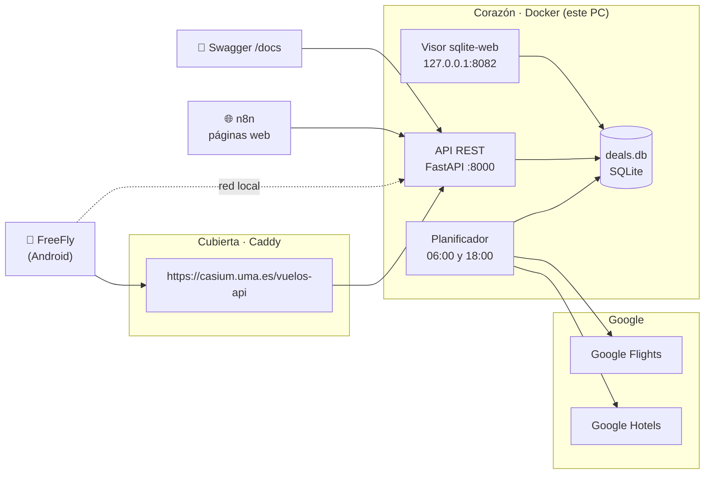

# ✈️🏨 API de vuelos y alojamiento baratos

Servicio que busca **escapadas baratas desde Málaga a las capitales europeas**: vuelo de ida y
vuelta + alojamiento, con precios reales de Google Flights y Google Hotels. Funciona solo:
dos veces al día recorre cientos de combinaciones de destino y fechas, guarda los precios en una
base de datos y los sirve **al instante** a una app Android (FreeFly), a páginas web hechas con n8n
o a cualquier cliente HTTP.

```text
Viaje más barato encontrado (23-11-2026):  Lisboa, jue 17/12 → sáb 19/12
  vuelo Ryanair 47 €  +  2 noches en Lisboa Parque Guest House 19 €  =  66 € por persona
```

## Índice

1. [Visión general](#1-visión-general)
2. [Puesta en marcha](#2-puesta-en-marcha)
3. [El corazón: el contenedor Docker](#3-el-corazón-el-contenedor-docker)
4. [La cubierta: publicación en Internet](#4-la-cubierta-publicación-en-internet)
5. [La API](#5-la-api)
6. [Los clientes](#6-los-clientes) — FreeFly (Android), n8n, Swagger y visor de la base de datos
7. [Configuración](#7-configuración)
8. [Seguimiento diario de una ruta y alertas](#8-seguimiento-diario-de-una-ruta-y-alertas)
9. [Mantenimiento y problemas conocidos](#9-mantenimiento-y-problemas-conocidos)
10. [Archivos del proyecto](#10-archivos-del-proyecto)

---

## 1. Visión general



El sistema tiene cuatro capas:

| Capa | Qué es | Dónde |
|---|---|---|
| **Corazón** | Un contenedor Docker con la API, el planificador que consulta Google y la base de datos SQLite | Este PC (`150.214.109.26`) |
| **Cubierta** | Caddy publica la API con HTTPS en una URL pública | `https://casium.uma.es/vuelos-api` |
| **API** | REST + JSON, protegida con la cabecera `X-API-Key` | `/api/...` |
| **Clientes** | App Android FreeFly, páginas web con n8n, Swagger, `curl` | Donde sea |

**Idea clave: precalcular.** Consultar Google cuesta 1-2 s por combinación y hay miles de
combinaciones. Por eso el servicio no busca cuando alguien pregunta, sino antes. Dos veces al día
consulta todas las combinaciones y guarda el resultado. Las apps leen de la base de datos y reciben
la respuesta en unos 50 ms. Solo si piden algo que no está precalculado (otro día de la semana, más
noches…) hace falta una búsqueda en vivo, que tarda minutos.

### Un día en la vida del servicio

| Hora | Qué ocurre | Duración |
|---|---|---|
| 06:00 | **Escaneo de vuelos**: 35 capitales × salidas jue/vie/sáb de las próximas 8 semanas × 2-4 noches = 2.520 consultas | ~30 min |
| ~06:30 | **Escaneo de alojamiento**: para los 200 vuelos más baratos (≤ 100 €), los ~18 alojamientos más económicos de cada uno | ~6 min |
| 08:00 | **Seguimiento de una ruta concreta** (AGP→LHR); si baja del umbral, avisa por webhook | segundos |
| 18:00 | Segundo escaneo de vuelos (el alojamiento no se repite: se renueva una vez al día) | ~30 min |
| Siempre | La API responde con lo último guardado | ~50 ms |

---

## 2. Puesta en marcha

Requisitos: Docker Desktop (o Docker Engine + Compose). En la carpeta del proyecto:

```bash
cp .env.example .env            # 1. pon tu clave en API_KEY (.env no se sube a git)
docker compose up -d --build    # 2. construye la imagen (~1,6 GB con Chromium) y arranca
docker compose logs -f flights  # 3. mira cómo arranca y lanza el primer escaneo
```

Comprobaciones (sustituye `$API_KEY` por tu clave):

```bash
curl http://localhost:8000/health
# {"status":"ok","tracking":true,"auth":true}

curl -H "X-API-Key: $API_KEY" "http://localhost:8000/api/deals/latest?sort=total&limit=3"
```

- Documentación interactiva: <http://localhost:8000/docs> (botón **Authorize**, introduce la clave).
- Visor de la base de datos: <http://127.0.0.1:8082>.
- La primera vez la base de datos está vacía: el primer escaneo empieza solo al arrancar y tarda
  ~35 min. Mientras tanto `/api/deals/latest` devuelve `coverage_ok: false`.

---

## 3. El corazón: el contenedor Docker

### Servicios (`docker-compose.yml`)

| Servicio | Contenedor | Puerto | Qué hace |
|---|---|---|---|
| `flights` | `flight-tracker` | `8000` (todas las interfaces) | API + planificador + escaneos |
| `db-viewer` | `flight-db-viewer` | `127.0.0.1:8082` (solo este PC) | [sqlite-web](https://github.com/coleifer/sqlite-web) en solo lectura sobre `deals.db` |

Los dos tienen `restart: unless-stopped`: arrancan con Docker y se recuperan solos de un fallo.

### La imagen (`Dockerfile`)

`python:3.11-slim-bookworm` + dependencias fijadas en `requirements.txt` + Chromium de Playwright.

| Componente | Para qué |
|---|---|
| `fast-flights 2.2` + `primp 0.14.0` | Leer Google Flights con una petición HTTP que imita a Chrome (rápido, sin navegador) |
| `playwright` + Chromium | Google Hotels (exige navegador) y plan B de Google Flights |
| `fastapi` + `uvicorn` | La API REST |
| `schedule` | Planificador interno (escaneos y seguimiento diario) |

### Dentro del contenedor

| Módulo | Responsabilidad |
|---|---|
| `api.py` | Arranca la API, la autenticación y el hilo planificador |
| `flight_tracker.py` | Consulta a Google Flights, validación, historial CSV, webhook |
| `deals.py` | Búsqueda en vivo de ofertas a capitales (trabajos en segundo plano) |
| `precompute.py` | Escaneos programados y base de datos (`/api/deals/latest`) |
| `hotels.py` | Alojamiento en Google Hotels con Chromium headless (`/api/hotels`) |

### Datos persistentes (`./data`, montado en `/data`)

| Archivo | Contenido |
|---|---|
| `deals.db` | Base de datos SQLite (ver tablas abajo) |
| `prices.csv` | Historial diario del seguimiento de una ruta |

Tablas de `deals.db`:

| Tabla | Una fila por… | Columnas principales |
|---|---|---|
| `prices` | destino × fecha de salida × noches | `price`, `prev_price` (escaneo anterior), `airline`, horarios, `stops`, `google_flights_url`, `checked_at` |
| `hotel_searches` | búsqueda de alojamiento (destino × entrada × noches) | `url`, `found`, `checked_at` |
| `hotels` | alojamiento encontrado en esa búsqueda | `rank`, `name`, `price_total`, `price_night`, `rating`, `reviews`, `stars`, `hostel`, `url` |
| `scans` | escaneo de vuelos | `started_at`, `finished_at`, `status`, `total`, `found`, `errors` |

Las salidas ya pasadas se borran solas.

### Comandos útiles

```bash
docker compose ps                         # estado
docker compose logs -f flights            # registro en directo
docker compose up -d --build flights      # aplicar cambios de código
docker compose restart flights            # reiniciar (si no hay datos recientes, reescanea)
curl -X POST -H "X-API-Key: $API_KEY" localhost:8000/api/deals/scans   # escanear ya
curl -X POST -H "X-API-Key: $API_KEY" localhost:8000/api/hotels/scan   # alojamiento ya
```

---

## 4. La cubierta: publicación en Internet

| Acceso | URL | Para quién |
|---|---|---|
| Local | `http://localhost:8000/` | Este PC (n8n, pruebas) |
| Red de la universidad | `http://150.214.109.26:8000/` | Móviles y PCs de la red de la UMA |
| Internet (HTTPS) | `https://casium.uma.es/vuelos-api/` | Cualquiera: la app en producción |

### Caddy

La máquina `casium.uma.es` reenvía `/vuelos-api/*` a este PC. `handle_path` **quita el prefijo**
antes de reenviar, y Caddy obtiene y renueva el certificado HTTPS solo:

```caddy
casium.uma.es {
    redir /vuelos-api /vuelos-api/ 308
    handle_path /vuelos-api/* {
        reverse_proxy 150.214.109.26:8000
    }
}
```

### `ROOT_PATH`

Como Caddy quita el prefijo, la API recibe `/api/...` y no sabe que el público la ve en
`/vuelos-api/api/...`. `ROOT_PATH: "/vuelos-api"` (en `docker-compose.yml`) se lo dice, para que
Swagger (`/docs`) cargue `/vuelos-api/openapi.json`. Consecuencias:

- `https://casium.uma.es/vuelos-api/docs` funciona.
- `http://150.214.109.26:8000/docs` deja de cargar (busca el prefijo). La API en sí sigue
  funcionando por las dos URL.
- Sin proxy, deja `ROOT_PATH: ""`.

### Firewall

Para que Caddy y los móviles lleguen al puerto 8000 de este PC (PowerShell como administrador):

```powershell
New-NetFirewallRule -DisplayName "Flight API 8000" -Direction Inbound -Protocol TCP -LocalPort 8000 -Action Allow
```

Comprobación desde otra máquina: abrir `http://150.214.109.26:8000/health` en el navegador.

---

## 5. La API

### Lo básico

- **Autenticación**: todas las rutas `/api/...` exigen la cabecera `X-API-Key: <clave>` (la de
  `API_KEY` en `.env`). `/health` y `/docs` no la piden.
- **Formato**: JSON. Fechas `AAAA-MM-DD`. Días de la semana: `0` = lunes … `6` = domingo.
- **Precios**: en EUR y **por persona**. Vuelo = ida y vuelta. Alojamiento = total de todas las
  noches con impuestos.
- **Errores**:

| Código | Significado | `detail` |
|---|---|---|
| `401` | Falta la clave o es incorrecta | texto |
| `404` | Función desactivada (p. ej. precálculo) | texto |
| `409` | Ya hay un escaneo en curso | texto |
| `422` | Parámetros inválidos | lista de textos **o** lista de objetos con `msg` (validación de FastAPI) |
| `429` | Demasiadas búsquedas en vivo a la vez | texto |
| `502` | Google no devolvió datos | texto |

### Mapa de rutas

| Método | Ruta | Respuesta | Para qué |
|---|---|---|---|
| GET | `/health` | inmediata | ¿Está viva la API? (sin clave) |
| **GET** | **`/api/deals/latest`** | **~50 ms** | **Ofertas precalculadas con alojamiento. La ruta principal** |
| GET | `/api/hotels` | ~50 ms (guardado) · 3-10 s (en vivo) | Alojamientos de un destino y unas fechas |
| GET | `/api/deals/capitals` | inmediata | Las 35 capitales y sus códigos |
| POST | `/api/deals` | 202 + `job_id` | Búsqueda en vivo de ofertas (lo no precalculado) |
| GET | `/api/deals/{job_id}` | inmediata | Progreso y resultados parciales de esa búsqueda |
| DELETE | `/api/deals/{job_id}` | inmediata | Cancelarla |
| GET | `/api/search` | 1-2 s | Vuelos de una ruta y fecha concretas |
| GET / POST | `/api/deals/scans` | inmediata | Ver / lanzar escaneos de vuelos |
| POST | `/api/hotels/scan` | 202 | Lanzar ya el escaneo de alojamiento |
| GET / POST | `/api/tracker`, `/api/tracker/check`, `/api/history` | — | Seguimiento diario de una ruta (sección 8) |

### Flujo recomendado para un cliente

```text
1. GET /api/deals/latest?...          ← siempre primero (instantáneo)
       │
       ├─ coverage_ok = true  → mostrar deals (cada uno ya trae su mejor alojamiento)
       │                         └─ ¿ver más alojamientos?  GET /api/hotels?destination&checkin&checkout
       │
       └─ coverage_ok = false → mostrar coverage_notes y ofrecer "Buscar en vivo":
                                 POST /api/deals  →  GET /api/deals/{job_id} cada 3 s  →  (DELETE al salir)
```

### `GET /api/deals/latest` — ofertas precalculadas

| Parámetro | Defecto | Descripción |
|---|---|---|
| `max_price` | `100` | Precio máximo del **vuelo** |
| `max_total` | — | Precio máximo de **vuelo + alojamiento** |
| `weekdays` | todos los precalculados | Días de salida: `4` o `3,4,5` |
| `min_nights`, `max_nights` | los precalculados (2-4) | Noches de estancia |
| `date_from`, `date_to` | toda la ventana | Rango de fechas de salida |
| `destinations` | todas | Códigos: `LON,ROM,LIS` |
| `max_stops` | — | `0` = solo directos |
| `sort` | `price` | `price` = por vuelo; `total` = por vuelo + alojamiento |
| `include_hostels` | `true` | `false` excluye albergues (cama en habitación compartida) |
| `hotel_min_rating`, `hotel_min_reviews` | `3.5`, `20` | Calidad mínima del alojamiento |
| `limit` | `100` | Máximo de ofertas devueltas |

```bash
curl -H "X-API-Key: $API_KEY" "http://localhost:8000/api/deals/latest?sort=total&max_total=120&include_hostels=false&limit=1"
```

```json
{
  "source": "precomputed",
  "updated_at": "2026-11-23T06:38:17+01:00", "age_minutes": 12,
  "scan_running": null,
  "coverage": {"origin": "AGP", "date_from": "2026-11-25", "date_to": "2027-01-19",
               "weekdays": [3, 4, 5], "min_nights": 2, "max_nights": 4},
  "coverage_ok": true, "coverage_notes": [],
  "deals_count": 75,
  "deals": [{
    "destination": "LIS", "city": "Lisboa", "country": "Portugal",
    "departure_date": "2026-12-17", "return_date": "2026-12-19", "nights": 2,
    "price": 47.0, "prev_price": 47.0, "price_change": 0.0, "currency": "EUR", "price_level": "low",
    "airline": "Ryanair", "departure": "8:50 PM on Thu, Dec 17", "arrival": "9:15 PM on Thu, Dec 17",
    "duration": "1 hr 25 min", "stops": 0, "stops_text": "directo",
    "checked_at": "2026-11-23T06:08:15+01:00",
    "google_flights_url": "https://www.google.com/travel/flights?tfs=...",
    "hotel": {"hotel_id": "ChkI...", "name": "Lisboa Parque Guest House", "price_total": 19.0,
              "price_night": 9.5, "currency": "EUR", "rating": 3.5, "reviews": 321, "stars": null,
              "hostel": false, "url": "https://www.google.com/travel/hotels/entity/.../prices?ts=..."},
    "hotels_checked": true,
    "trip_total": 66.0,
    "google_hotels_url": "https://www.google.com/travel/search?q=hoteles%20en%20Lisboa&ts=..."
  }],
  "cheapest_by_destination": [{"destination": "LIS", "price": 47.0, "trip_total": 66.0, "is_deal": true, "...": "..."}]
}
```

Cómo leer la respuesta:

- `coverage_ok: false` → lo pedido queda fuera de lo precalculado; `coverage_notes` dice por qué
  (`"Días de salida no precalculados: lun"`). Hay que usar la búsqueda en vivo.
- `age_minutes` → antigüedad del último escaneo ("Actualizado hace 12 min").
- `price_change` < 0 → el vuelo ha bajado respecto al escaneo anterior.
- `hotel` → el alojamiento más barato que cumple los filtros, o `null`. `hotels_checked: false`
  significa que aún no se ha buscado alojamiento para esa oferta (solo se busca para los 200 vuelos
  más baratos); `google_hotels_url` sirve en ambos casos para buscarlo en Google.
- `departure` / `arrival` vienen de Google en inglés: la hora es lo que va antes de `" on "`.
- `cheapest_by_destination` → lo más barato de cada capital, sea oferta o no.

### `GET /api/hotels` — alojamientos de un destino

| Parámetro | Defecto | Descripción |
|---|---|---|
| `destination` | obligatorio | Código de capital (`LIS`) o nombre de ciudad |
| `checkin`, `checkout` | obligatorios | Entrada (día del vuelo de ida) y salida (día de vuelta) |
| `adults` | `1` | Huéspedes (con más de 1 siempre busca en vivo) |
| `min_rating`, `min_reviews` | `3.5`, `20` | Calidad mínima |
| `max_price_night` | — | Precio máximo por noche |
| `include_hostels` | `true` | Incluir albergues |
| `limit` | `10` | Máximo de resultados |
| `refresh` | `false` | Ignorar lo guardado y buscar en vivo |

```json
{
  "destination": "LIS", "city": "Lisboa", "checkin": "2026-12-17", "checkout": "2026-12-19",
  "nights": 2, "adults": 1, "source": "precomputed", "checked_at": "2026-11-23T10:40:12+01:00",
  "google_hotels_url": "https://www.google.com/travel/search?...", "found": 18, "count": 12,
  "hotels": [{"name": "White House Lisbon Hostel", "price_total": 18.0, "price_night": 9.0,
              "rating": 4.0, "reviews": 279, "stars": 1, "hostel": true, "url": "https://..."}]
}
```

`source` es `precomputed` (de la base de datos, < 48 h) o `live` (búsqueda en el momento).

### Búsqueda en vivo de ofertas — `POST /api/deals`

Para lo que no cubre el precálculo. Prueba combinaciones destino × fecha × noches en segundo plano:

```bash
curl -X POST -H "X-API-Key: $API_KEY" -H "Content-Type: application/json" \
  -d '{"max_price": 100, "departure_weekdays": [0], "min_nights": 2, "max_nights": 3}' \
  http://localhost:8000/api/deals
# 202 {"job_id":"aef5c671c90f","status":"running","total_queries":280,"estimated_seconds":121,...}

curl -H "X-API-Key: $API_KEY" "http://localhost:8000/api/deals/aef5c671c90f?limit=20"
# {"status":"running","progress":{"done":120,"total":280,"errors":3,"percent":42.9},"deals":[...],...}
```

| Campo del cuerpo | Defecto | Descripción |
|---|---|---|
| `origin` | `AGP` | Aeropuerto de salida |
| `max_price` | `100` | Precio máximo ida y vuelta |
| `date_from` / `date_to` | hoy + 7 / + 4 semanas | Rango de salidas (máx. 180 días) |
| `min_nights` / `max_nights` | `2` / `3` | Estancia |
| `departure_weekdays` | — | `[4]` = viernes. Sin él, una salida cada `step_days` (7) días |
| `destinations` | las 35 | `["LON","ROM"]` |
| `adults`, `seat_class`, `max_stops`, `currency` | `1`, `economy`, —, `EUR` | |

- Nº de consultas = destinos × salidas × noches; más de 400 → `422` con la cifra. Ritmo: ~2 por segundo.
- `status` final: `done` o `cancelled`. Los resultados parciales llegan mientras corre.
- Como máximo 2 búsquedas a la vez (`429`); los resultados se guardan en memoria 1 h.
- No incluye alojamiento: para eso, `GET /api/hotels` con las fechas de cada oferta.

### `GET /api/search` — una ruta concreta

```bash
curl -H "X-API-Key: $API_KEY" \
  "http://localhost:8000/api/search?origin=AGP&destination=CDG&departure_date=2026-12-15&return_date=2026-12-20&limit=3"
```

Parámetros: `origin`, `destination`, `departure_date` (obligatorios), `return_date` (vacío = solo
ida), `adults`, `seat_class` (`economy`, `premium-economy`, `business`, `first`), `max_stops`,
`currency`, `limit` (1-50), `refresh`. Respuesta: `min_price`, `price_level`, `flights[]` con
aerolínea, horarios, duración y escalas. Búsquedas idénticas se sirven de caché 15 min.

**Códigos de ciudad.** Se usan `LON`, `PAR`, `ROM`, `STO`… en lugar de un aeropuerto concreto, para
incluir todos los de la ciudad (Stansted, Beauvais, Ciampino…). Abarata mucho: AGP→LHR 286 € frente
a AGP→LON 113 €.

---

## 6. Los clientes

### 6.1 FreeFly (app Android)

Repositorio: <https://github.com/Narjistf/FreeFly> (clon local en `D:\dev\android\freefly`).

| | |
|---|---|
| Paquete | `es.narjis.freefly` |
| Tecnología | Kotlin, Jetpack Compose + Material 3, ViewModel + StateFlow, Retrofit + OkHttp + Gson |
| SDK | mínimo 24, objetivo 37 |
| Estado actual | Pantalla con dos botones: **Test /health** y **Cargar ofertas** (`/api/deals/latest`) en tarjetas |

Estructura:

```text
app/src/main/java/es/narjis/freefly/
├── MainActivity.kt                    pantalla (Compose): botones, lista de tarjetas DealItem
├── ui/viewmodel/FlightViewModel.kt    estado de la pantalla (Idle, Loading, HealthSuccess, DealsSuccess, Error)
├── data/repository/FlightRepository.kt  llamadas a la API en Dispatchers.IO, devuelve Result<…>
├── data/remote/FlightApiService.kt    interfaz Retrofit: GET health, GET api/deals/latest
├── data/remote/RetrofitClient.kt      URL base, clave (interceptor X-API-Key), timeouts, logging
├── data/model/FlightModels.kt         HealthResponse, DealsResponse, Deal (@SerializedName)
└── network/NetworkClient.kt           cliente OkHttp genérico (sin usar todavía)
```

**Conectar la app al servidor** (`RetrofitClient.kt`):

| Dónde corre la app | `BASE_URL` |
|---|---|
| Emulador en este mismo PC | `http://10.0.2.2:8000/` |
| Móvil en la red de la UMA | `http://150.214.109.26:8000/` (actual) |
| Cualquier sitio (producción) | `https://casium.uma.es/vuelos-api/` |

Dos reglas de Retrofit que hay que respetar:

1. La URL base **termina en `/`**.
2. Las rutas de `@GET` **no empiezan por `/`** (`@GET("api/deals/latest")`). Con una `/` inicial,
   Retrofit descartaría el `/vuelos-api` de la URL de producción.

Al pasar a HTTPS se puede quitar `android:usesCleartextTraffic="true"` del `AndroidManifest.xml`.
La clave está ahora como constante en `RetrofitClient.kt`; para no subirla a git se puede leer de
`local.properties` y exponer como `BuildConfig.API_KEY` (así lo plantea `prompt_android_gemini.md`).

**Siguientes pasos para mostrar el alojamiento.** La API ya lo devuelve; basta con ampliar el
modelo y la pantalla:

```kotlin
data class Hotel(
    @SerializedName("name") val name: String,
    @SerializedName("price_total") val priceTotal: Double,
    @SerializedName("price_night") val priceNight: Double,
    @SerializedName("rating") val rating: Double? = null,
    @SerializedName("reviews") val reviews: Int? = null,
    @SerializedName("hostel") val hostel: Boolean = false,
    @SerializedName("url") val url: String? = null
)

// Añadir a Deal:
    @SerializedName("hotel") val hotel: Hotel? = null,
    @SerializedName("trip_total") val tripTotal: Double? = null,
    @SerializedName("google_hotels_url") val googleHotelsUrl: String? = null

// Añadir a getLatestDeals(...):
    @Query("sort") sort: String? = "total",
    @Query("include_hostels") includeHostels: Boolean? = null,
    @Query("max_total") maxTotal: Double? = null
```

Y en `DealItem`: el `tripTotal` destacado, una línea con el alojamiento, y al tocar abrir
`googleFlightsUrl` o `hotel.url` con `Intent(Intent.ACTION_VIEW, Uri.parse(url))`.

`prompt_android_gemini.md` (en esta carpeta) es un prompt completo para que Gemini en Android
Studio genere el resto: filtros, búsqueda en vivo con progreso, manejo de errores y pantalla de
detalle de alojamientos.

### 6.2 n8n (páginas web)

Dos flujos listos para importar en n8n (**Workflows → Import from file**). Cada uno publica una
página web completa, con formulario de filtros, en un webhook:

| Archivo | URL (n8n en `localhost:5678`) | Muestra |
|---|---|---|
| `flujo_n8n.json` | `/webhook/vuelos` | Ofertas de vuelo. Si lo pedido no está precalculado, lanza la búsqueda en vivo y espera |
| `flujo_n8n_hoteles.json` | `/webhook/hoteles` | Vuelos + los 3 alojamientos más baratos de cada uno, ordenados por viaje completo |

Tras importar:

1. Abre el primer nodo de código y pon tu clave en `const API_KEY = 'TU_API_KEY';`.
2. Ajusta `const API` si hace falta:
   - n8n en Docker Desktop: `http://host.docker.internal:8000` (el valor por defecto).
   - n8n en la misma red Docker que la API: `http://flight-tracker:8000`.
   - n8n instalado en el PC: `http://localhost:8000`.
3. Activa el flujo y abre la URL del webhook en el navegador.

**Flujo de vuelos** (11 nodos):

```text
Webhook → Preparar petición → Ofertas precalculadas → ¿Sirve lo precalculado?
            sí → Generar página HTML → Responder
            no → Iniciar escaneo → ¿Creado? → Esperar 5 s → Consultar progreso → ¿Sigue? (bucle) → HTML
```

Parámetros de la URL: `max_price`, `weekdays` (`4,5` o `any`), `min_nights`, `max_nights`,
`date_from`, `date_to`, `destinations`, `origin`, `max_stops`, `sort=total`, `max_total`,
`hostels=0`, y `live=1` para forzar la búsqueda en vivo.

**Flujo de vuelos y hoteles** (4 nodos):

```text
Webhook → Consultar API (latest + /api/hotels de cada oferta, en paralelo) → Generar página HTML → Responder
```

Usa siempre lo precalculado, así que responde en menos de medio segundo. Parámetros: los de
vuelos más `max_total`, `hostels=0`, `min_rating`, `sort=price`, `limit` (20, máx. 50) y
`per_deal` (alojamientos por oferta, 3). Ejemplo: `/webhook/hoteles?hostels=0&max_total=120`.

### 6.3 Otras herramientas

| Herramienta | URL | Uso |
|---|---|---|
| Swagger | `http://localhost:8000/docs` · `https://casium.uma.es/vuelos-api/docs` | Probar cada ruta desde el navegador (**Authorize** → clave) |
| Visor de la BD | `http://127.0.0.1:8082` | Tablas `prices`, `hotels`, `scans`… y consultas SQL (pestaña *Query*) |
| `curl` | — | Ejemplos en la sección 5 |

Consultas útiles en el visor:

```sql
-- Bajadas de precio del último escaneo
SELECT destination, departure_date, nights, prev_price, price, price - prev_price AS cambio
FROM prices WHERE prev_price IS NOT NULL AND price < prev_price ORDER BY cambio LIMIT 30;

-- Viaje completo más barato por destino
SELECT p.destination, p.departure_date, p.nights, p.price AS vuelo, h.name, h.price_total AS aloj,
       MIN(p.price + h.price_total) AS total
FROM prices p JOIN hotels h ON h.destination = p.destination AND h.checkin = p.departure_date
                           AND h.nights = p.nights AND h.rank = 0
GROUP BY p.destination ORDER BY total;
```

---

## 7. Configuración

Todo se configura con variables de entorno en `docker-compose.yml`, salvo la clave, que va en
`.env`. Tras cambiar algo: `docker compose up -d`.

### Secretos (`.env`, no se sube a git)

| Variable | Descripción |
|---|---|
| `API_KEY` | Clave que los clientes envían en `X-API-Key`. Vacía = API abierta |

`.env.example` es la plantilla.

### API y publicación

| Variable | Defecto | Descripción |
|---|---|---|
| `ROOT_PATH` | vacío | Prefijo público tras el proxy (`/vuelos-api`), ver sección 4 |
| `CACHE_TTL_SECONDS` | `900` | Caché de búsquedas idénticas |
| `PORT` | `8000` | Puerto interno |
| `TZ` | `Europe/Madrid` | Zona horaria de los horarios |

### Precálculo de vuelos

| Variable | Defecto | Descripción |
|---|---|---|
| `PRECOMPUTE_ENABLED` | `true` | Activarlo |
| `PRECOMPUTE_TIMES` | `06:00,18:00` | Horas de los escaneos |
| `PRECOMPUTE_WEEKDAYS` | `3,4,5` | Días de salida (jue, vie, sáb) |
| `PRECOMPUTE_NIGHTS` | `2-4` | Noches |
| `PRECOMPUTE_WEEKS` | `8` | Semanas hacia delante |
| `PRECOMPUTE_START_DAYS` | `2` | Primera salida: hoy + N días |
| `PRECOMPUTE_STALE_HOURS` | `12` | Al arrancar, escanear si el último es más viejo |
| `PRECOMPUTE_MAX_AGE_HOURS` | `36` | No servir precios más viejos |
| `PRECOMPUTE_DB` | `/data/deals.db` | Base de datos |

Cada día de la semana o noche añadida suma 840 consultas (~10 min) por escaneo.

### Alojamiento

| Variable | Defecto | Descripción |
|---|---|---|
| `HOTELS_ENABLED` | `true` | Buscar alojamiento tras cada escaneo |
| `HOTELS_FLIGHT_MAX_PRICE` | `100` | Solo para vuelos ≤ este precio |
| `HOTELS_MAX_SEARCHES` | `200` | Búsquedas por escaneo (las de vuelo más barato primero) |
| `HOTELS_STALE_HOURS` | `20` | No repetir una búsqueda más reciente |
| `HOTELS_MAX_AGE_HOURS` | `48` | No servir alojamiento más viejo |
| `HOTELS_CONCURRENCY` | `2` | Navegadores simultáneos (~300 MB cada uno) |
| `HOTELS_MIN_RATING` / `HOTELS_MIN_REVIEWS` | `3.5` / `20` | Filtros por defecto de la API |

### Búsqueda en vivo de ofertas

| Variable | Defecto | Descripción |
|---|---|---|
| `DEALS_ORIGIN` | `AGP` | Origen por defecto (y del precálculo) |
| `DEALS_WORKERS` | `3` | Consultas en paralelo |
| `DEALS_MAX_QUERIES` | `400` | Límite de consultas por búsqueda |
| `DEALS_FETCH_MODE` | `common` | Modo de consulta a Google (ver sección 9) |

---

## 8. Seguimiento diario de una ruta y alertas

Además de las ofertas, el servicio vigila **una ruta concreta** cada día y avisa si baja de precio.

| Variable | Defecto | Descripción |
|---|---|---|
| `ORIGIN`, `DESTINATION` | `AGP`, `LHR` | Ruta (vacías = desactivado) |
| `DEPARTURE_DATE`, `RETURN_DATE` | `2026-12-15`, vacío | Vacía la vuelta = solo ida |
| `ADULTS`, `SEAT_CLASS`, `MAX_STOPS`, `CURRENCY` | `1`, `economy`, —, `EUR` | |
| `PRICE_THRESHOLD` | `80` | Alerta si el mínimo es **inferior** |
| `SCHEDULE_TIME` | `08:00` | Hora diaria |
| `RUN_ON_START` | `true` | Comprobar también al arrancar |
| `WEBHOOK_URL` | vacío | Adónde enviar la alerta |
| `WEBHOOK_MODE` | `alert` | `alert` = solo bajo umbral; `always` = también resumen diario |
| `TELEGRAM_CHAT_ID` | vacío | Si el webhook es de Telegram |
| `DATA_FILE` | `/data/prices.csv` | Historial |
| `TOP_N` | `5` | Vuelos mostrados en el registro |

Rutas: `GET /api/tracker` (configuración y último resultado), `POST /api/tracker/check`
(comprobar ya), `GET /api/history` (historial; filtrable por `origin`, `destination`,
`departure_date`, `return_date`).

El webhook adapta el mensaje al destino:

- **Discord** (`discord.com/api/webhooks/…`) → `{"content": "…"}`
- **Telegram** (`api.telegram.org/bot<TOKEN>/sendMessage`) → `{"chat_id": …, "text": "…"}`
- **Cualquier otro** (n8n, Make, Home Assistant…) → JSON completo con `event` (`price_alert` o
  `daily_summary`), ruta, `min_price`, `threshold`, aerolínea, horarios, `message`…

También se puede ejecutar sin la API, p. ej. desde cron (`0 8 * * *`):

```bash
docker compose run --rm -e RUN_MODE=once flights python flight_tracker.py
```

---

## 9. Mantenimiento y problemas conocidos

**Cómo se lee Google.** No hay APIs oficiales: el servicio lee las páginas de Google como lo haría
un navegador. Funciona, pero depende de que Google no cambie su HTML.

| Pieza | Cómo funciona | Si deja de funcionar |
|---|---|---|
| Vuelos | `fast-flights` (petición HTTP que imita a Chrome, modo `common`); si falla, Chromium (`local`) | Actualizar `fast-flights` |
| Alojamiento | Chromium abre Google Hotels ordenado por precio y `EXTRACT_JS` (`hotels.py`) lee las fichas | Ajustar `EXTRACT_JS`; `/api/hotels` devolverá listas vacías mientras tanto |
| Fechas en Google Hotels | Google ignora `checkin`/`checkout` en la URL; van codificadas en el parámetro `ts` (protobuf en base64) que genera `build_ts` | Revisar el formato de `ts` |

Problemas ya resueltos (por si reaparecen):

- **Página de consentimiento de cookies (UE)**: desde IPs europeas Google redirige a
  `consent.google.com`. Se envía una cookie `SOCS` que lo evita; si Google la invalida, copia la
  de tu navegador en la variable `GOOGLE_SOCS`.
- **`Invalid impersonate: "chrome_126"`**: `fast-flights 2.2` no funciona con `primp >= 1.0`; por
  eso está fijado `primp==0.14.0`.
- **Modo `fallback` de fast-flights** (`try.playwright.tech`): desde noviembre de 2026 responde
  `401`; no se usa.
- **Destinos sin datos**: desde Málaga, Skopie (`SKP`) no devuelve vuelos. Bucarest usa `OTP`
  porque el código de ciudad `BUH` falla.
- **Albergues**: se reconocen por el nombre (hostel, albergue, хостел, Generator, Clink…); alguno
  con nombre poco claro puede escaparse.

Modos de consulta a Google Flights (`FETCH_MODE` para el seguimiento, `DEALS_FETCH_MODE` para
ofertas): `common` (HTTP, rápido), `local` (Chromium, lento), `auto` (`common` y si falla `local`).

Imagen sin navegador (mucho más pequeña, pero sin alojamiento ni plan B para vuelos):
`docker compose build --build-arg INSTALL_PLAYWRIGHT=false` y `HOTELS_ENABLED: "false"`.

---

## 10. Archivos del proyecto

| Archivo | Qué es |
|---|---|
| `Dockerfile` | Imagen: Python 3.11 + dependencias + Chromium |
| `docker-compose.yml` | Servicios `flights` y `db-viewer`, toda la configuración |
| `.env.example` | Plantilla de secretos (copiar a `.env`) |
| `requirements.txt` | Dependencias con versión fijada |
| `api.py` | API REST, autenticación, planificador |
| `flight_tracker.py` | Consulta a Google Flights, seguimiento diario, historial, webhook |
| `deals.py` | Capitales y búsqueda en vivo de ofertas |
| `precompute.py` | Escaneos programados, base de datos, `/api/deals/latest` |
| `hotels.py` | Alojamiento en Google Hotels, `/api/hotels` |
| `flujo_n8n.json` | n8n: página de ofertas de vuelo (`/webhook/vuelos`) |
| `flujo_n8n_hoteles.json` | n8n: página de vuelos + alojamiento (`/webhook/hoteles`) |
| `prompt_android_gemini.md` | Prompt para generar el cliente Android con Gemini |
| `data/` | `deals.db` y `prices.csv` (no se suben a git) |
